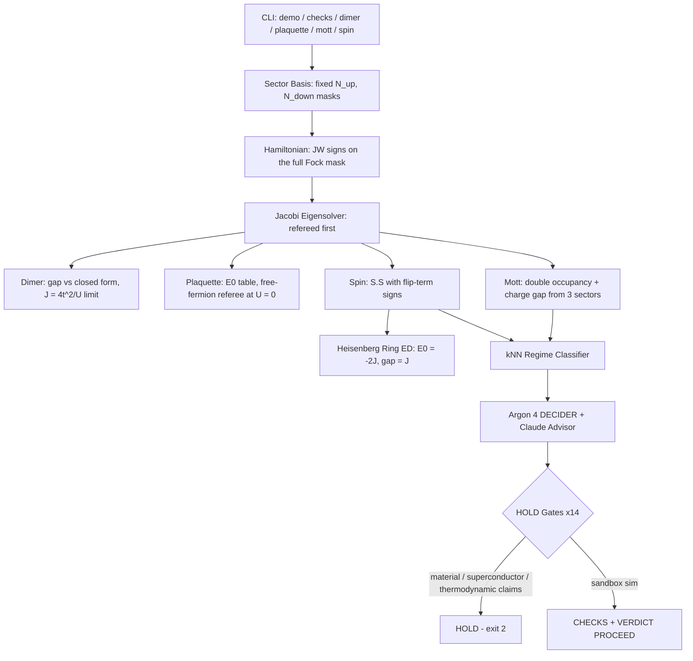
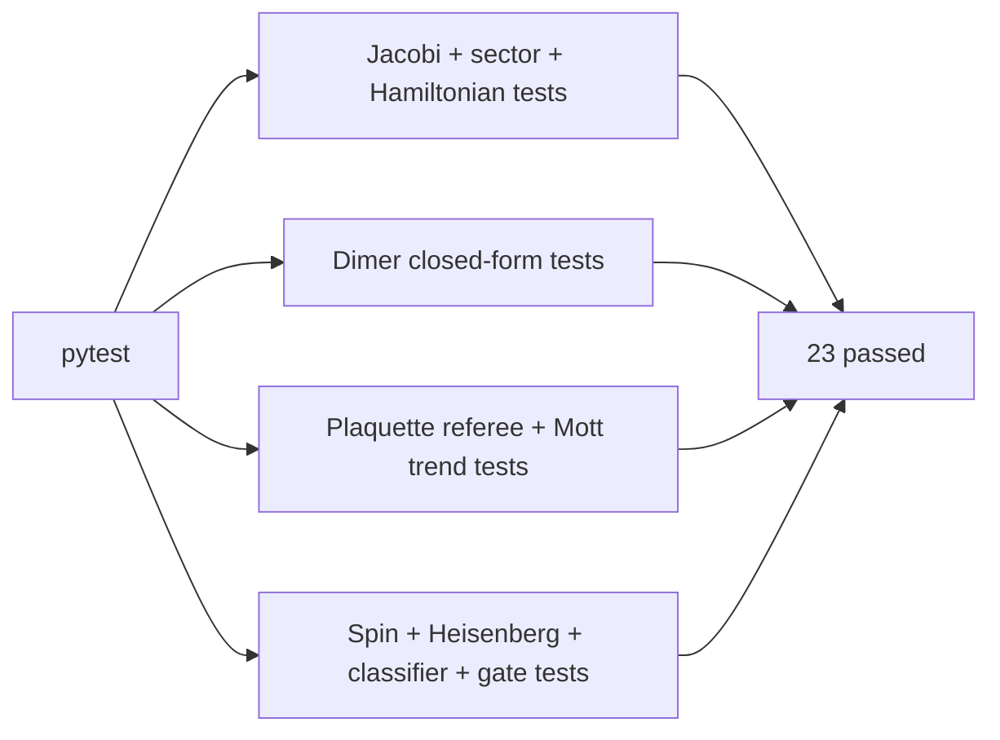
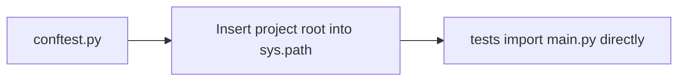
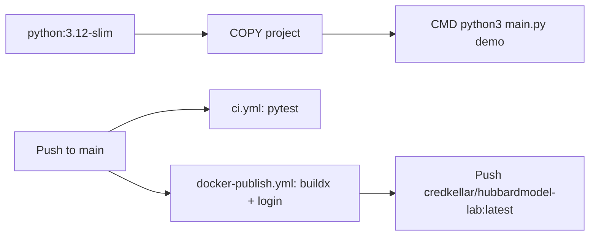

# HubbardModel-Lab 🧲⚛️

**Fermionic Hubbard Model Lab — Exact Diagonalisation, Mott Bookkeeping & the Heisenberg Limit** — by Darion Kellar

HubbardModel-Lab is an **educational fermionic Hubbard model lab** in ONE pure-Python file. It takes the smallest model of interacting electrons — hopping `t` against on-site repulsion `U` — and diagonalises it **exactly** on the two clusters where every number can be checked by hand:

- the **2-site dimer** at half filling, whose singlet–triplet gap is the closed form `(√(U² + 16t²) − U)/2` — the ED reproduces it to under 1e-9 across the whole U grid, and at U/t = 20 the gap sits at **0.9902 of 4t²/U**, the Heisenberg exchange J emerging from the diagonalisation;
- the **2×2 plaquette** (4 sites, half filling, sector dimension 36), whose U = 0 energy matches the free-fermion sum over single-particle levels **exactly (−4t)**, and on which the Mott argument is then bookkept in the open: double occupancy per site drains monotonically **0.249017 → 0.010508** as U/t goes 0 → 16, the charge gap `Δc = E(N+1) + E(N−1) − 2E(N)` grows monotonically **0 → 13.361465**, and the nearest-neighbour spin correlation strengthens monotonically to **−0.486884** — against the Heisenberg ring's exact −1/2, which the lab diagonalises itself as the referee.

Honest scope, stated up front: these are **two and four sites**. The U = 0 plaquette shell is degenerate (levels −2, 0, 0, +2 leave the zero level half-filled), and the lab says so wherever that matters — the U = 0 charge gap is exactly 0 because of it, not despite it. No real material was modelled, no phase of any real system is certified, and **no thermodynamic-limit, superconductivity, or device claim is computed or claimed anywhere** — those uses are permanent HOLD gates (14 total). 🔒

[](https://github.com/kimanicollier44-cmyk/HubbardModel-Lab/actions/workflows/ci.yml)
[](https://github.com/kimanicollier44-cmyk/HubbardModel-Lab/actions/workflows/docker-publish.yml)

> ℹ️ These are the **live** workflow badges for this repo. They activate as soon as the `ci.yml` and `docker-publish.yml` files from the paste pack are pasted into `.github/workflows/` — until then they have nothing to report yet.

## 🧰 Tech Stack Badges & Full Architecture Tech Stack

### 💻 Core Programming Languages & Core Systems


- 🐍 Python 3.12, pure standard library (`math`, `hashlib`, `json`, `sys`, `itertools`) — zero dependencies, zero network, deterministic (double-run byte-identical)
- ⚛️ Fermion core from scratch: occupation basis in fixed (N_up, N_down) sectors, **one Jordan-Wigner sign rule** (spin-orbitals ordered up-block then down-block; every sign is the parity of the full Fock mask) used for hopping and spin flips alike, and a cyclic **Jacobi eigensolver** for real symmetric matrices — with eigenvectors — that is refereed against known spectra before it is trusted with a Hamiltonian
- 🎯 Analytic referees everywhere: the dimer's closed-form spectrum, the free-fermion sum over single-particle levels at U = 0, Hellmann–Feynman (`D = dE0/dU`) checked against both the eigenvector and a finite difference, and the Heisenberg ring diagonalised in-lab (E0 = −2J, gap = J, ⟨S·S⟩ = −1/2)
- 🧲 Observable bookkeeping: double occupancy read off the ground-state vector, charge gap from three separate sector ground states E(N+1), E(N), E(N−1), and ⟨S_i·S_j⟩ with the flip terms applied as four-operator sequences on the Fock mask — the same sign rule as the Hamiltonian, so the observable cannot quietly use a different convention
- 🧠 TinyML kNN regime classifier (from scratch, stdlib, distance-weighted): weakly-correlated / correlated-metal / mott-like / heisenberg-like from (U/t, double occupancy, charge gap, spin correlation), labels from the lab's own policy
- 🪑 Council seats: Gemini Argon 4 DECIDER (names-only, tighten-only) + Muse advisor (never overrides HOLD) + Google Flow plan-only (rendered = False, live = 0)

### ⛓️ Web3 & Infrastructure

- 🚫 **Not applicable — honestly.** No blockchain, no Web3, no tokens: the "infrastructure" in this lab is one offline file holding a 4-dimensional and a 36-dimensional Hamiltonian. Real-material prediction and thermodynamic-limit claims are permanent HOLD gates, not features. No fake badges here.

### ⚙️ Platform Support & Hardware Architecture


- 🖥️ Pure Python — runs anywhere Python 3.12+ runs (Linux, macOS, Windows), plus the `python:3.12-slim` Docker image
- 🔒 No hardware is controlled, ever: real crystals, cold-atom lattices, and laboratory instruments are permanent HOLD gates (see the gate table below)

### ⚡ Low-Level Infrastructure & Performance

- 🚫 **No low-level code — honestly.** No C, no C++, no GPU, no compiled extensions: this is one interpreted Python file on purpose, so every matrix entry can be read, checked, and diffed. Performance here means honest algorithms — a Jacobi eigensolver instead of a library call, exact sector bases instead of sampling, expectation values read off eigenvectors instead of Monte Carlo — all deterministic and byte-identical between runs.

### 🛠️ DevOps & Build Tools


- 🐳 Docker (`python:3.12-slim`), GitHub Actions CI + Docker Publish (delivered in the paste pack)
- 🎯 Target image: `credkellar/hubbardmodel-lab:latest`
- 🧪 Tests: `pytest` (23 tests) + the built-in CHECKS suite (41 checks) in `main.py`

### ☁️ Cloud Providers

- 🚫 **None — honestly.** No cloud provider is used or needed: the lab runs fully offline on your own machine or in a local Docker container. Docker Hub appears only as the registry the publish workflow pushes the image to.

## What this does?

1. 🧰 **Fermion sector builder** — basis states are (up_mask, down_mask) pairs with fixed populations: the dimer sector has dimension 4, the half-filled plaquette sector 36, the charge-gap sectors (3,2) and (2,1) 24 each. The Hamiltonian is built by acting with `c†c` pairs on full Fock masks, so the trace over the plaquette sector (mean doublon count exactly 1 per state at half filling) and the matrix symmetry are asserted before any physics is read off.
2. 🔐 **One sign rule** — spin-orbitals are ordered up-block first, then down-block, and every fermionic sign in the file — hopping in the Hamiltonian, spin flips in ⟨S·S⟩ — is the Jordan-Wigner parity of that one ordering. There is no second convention for an observable to hide in.
3. 🎛️ **Jacobi eigensolver, refereed first** — a from-scratch cyclic Jacobi routine (eigenvalues *and* eigenvectors) must first reproduce {1, 3} for a 2×2 and the path-graph hopping spectrum {±1.618034, ±0.618034}, and its plaquette ground-state eigenvector must satisfy ‖Hv − Ev‖∞ < 1e-9, before a single Hubbard number is believed.
4. 🔬 **The dimer, exactly** — the (1,1) spectrum at U = 0 is {−2, 0, 0, +2}; the ground energy and the singlet–triplet gap match `(U − √(U² + 16t²))/2` and `(√(U² + 16t²) − U)/2` to < 1e-9 at every grid U (0, 1, 2, 4, 8, 12, 20). The triplet sits at exactly 0 — it never pays U, because its two electrons never share a site.
5. 📉 **The Heisenberg limit, emerging** — the dimer gap divided by `4t²/U` climbs 0.618034 (U = 2) → 0.828427 (U = 4) → 0.944272 (U = 8) → **0.990195** (U = 20): the effective Heisenberg exchange J = 4t²/U is not inserted anywhere, it falls out of the exact gap as U grows.
6. 🧮 **Plaquette energy table, refereed at U = 0** — E0 rises monotonically from **−4.000000** at U = 0 through −2.102748 (U = 4) to −0.722864 (U = 16). The U = 0 value is checked against an independent path: diagonalise the 4×4 single-particle hopping matrix (levels −2, 0, 0, +2) and fill the lowest two per spin. The degenerate zero level is also why the U = 0 spin gap is exactly 0 — printed, not smoothed over.
7. 🚪 **Mott bookkeeping** — double occupancy per site, read off the ground-state vector, falls monotonically: 0.249017 (U = 0, the uncorrelated 1/4 up to the degenerate-shell caveat) → 0.071831 (U = 4) → 0.032498 (U = 8) → **0.010508** (U = 16). On the dimer the same observable is triple-checked: eigenvector vs Hellmann–Feynman closed form vs finite difference of E0(U).
8. 🔋 **Charge gap from three sectors** — `Δc = E(5) + E(3) − 2E(4)` with each energy the ground state of its own sector. At U = 0 the open shell absorbs the extra electron for free and Δc = **0 exactly**; then it grows monotonically — 1.238351 (U = 2), 5.991359 (U = 8), **13.361465** (U = 16) — the plaquette's price for adding one more electron, computed, not asserted.
9. 🧲 **Spin correlations with honest signs** — ⟨S_i·S_j⟩ is evaluated with Sz·Sz plus the flip terms applied as operator sequences on the Fock mask. The dimer checks the machinery: −3/8 at U = 0 (half the weight is doublons, where the correlation vanishes) → −0.742718 at U = 20 (pure singlet −3/4). On the plaquette the nearest-neighbour value is negative for every U ≥ 1 and strengthens monotonically to −0.486884 at U = 16.
10. 🏷️ **Heisenberg referee + classifier + seats** — the lab diagonalises the 4-site Heisenberg ring itself (E0 = −2J, spin gap = J, ⟨S·S⟩ = −1/2 exactly) and reports the plaquette against it: spin correlation within 0.014 of −1/2 and spin gap at 0.893 of J at U/t = 16 — close, not equal, with the remaining distance named as charge fluctuation. A from-scratch distance-weighted kNN then labels computed ground states weakly-correlated / correlated-metal / mott-like / heisenberg-like from the lab's own policy (kNN == policy asserted on every scenario and all 1,080 grid rows), alongside Argon 4 DECIDER (sha256 trace), Muse advisor, Google Flow plan-only, 14 HOLD gates, and a CHECKS suite (41 checks) re-deriving every headline above.

## 🗺️ How it works — diagram per script

### `main.py` — the whole lab



### `tests/test_main.py` — verification



### `conftest.py` — test path setup



### `Dockerfile` + CI flow — container & publish



## Why is this cool?

1. 🎯 The dimer gap is **a formula with a receipt**: `(√(U² + 16t²) − U)/2` is not quoted at the ED — the ED is graded against it at seven U values and agrees to under 1e-9 every time.
2. 🧲 The Heisenberg model **emerges on camera**: nothing in the Hamiltonian knows about J, yet the exact gap divided by 4t²/U walks 0.618 → 0.828 → 0.944 → 0.990 as U grows — superexchange derived, not declared.
3. 🔐 **One sign rule for everything**: hopping and spin flips share the same Jordan-Wigner parity machinery, and the dimer spin correlation (−3/8 at U = 0, where half the state is doublons) proves the flip signs are the Hamiltonian's signs.
4. 🚪 The Mott transition is **bookkeeping you can audit**: doublons counted on the eigenvector drain monotonically while the charge gap — priced from three separate diagonalisations — opens monotonically. No order parameter is asserted; the ledger is the argument.
5. 🐚 The degenerate shell is **named, not hidden**: at U = 0 the plaquette's zero level is half-filled, the spin gap is exactly 0, and the charge gap is exactly 0 — the lab prints the caveat next to every number it touches instead of picking a prettier U.
6. ⚖️ Double occupancy is **triple-checked** on the dimer: eigenvector expectation, Hellmann–Feynman derivative of the closed-form energy, and a finite difference — three computations that share no code path.
7. 🪞 The Heisenberg referee is **diagonalised, not quoted**: the ring's −2J, J, and −1/2 come out of the same Jacobi solver, so "the plaquette approaches the Heisenberg limit" is a comparison of two computations, and the remaining gap at U/t = 16 (spin gap at 0.893 of J) is reported as part of the result.
8. 🧮 The U = 0 plaquette energy is **proved two ways**: many-body ED in a 36-state sector and a one-body sum over single-particle levels — a basis or sign bug anywhere would break the agreement, and it holds to < 1e-9.
9. 🏷️ The classifier's features are **the physics itself**: U/t, doublon density, charge gap, spin correlation — so when it calls U = 6 mott-like and U = 16 heisenberg-like, you can argue with the verdict number by number.
10. 🎯 Deterministic end to end: run it twice, get byte-identical output — a Hubbard lab you can diff.

## What problems this solves?

1. ❌ **Problem:** "The Hubbard model gives the Heisenberg model at large U" is usually a slogan. ✅ **Solution:** The dimer gap ratio to 4t²/U is computed at five U values and printed climbing to 0.990195; on the plaquette the spin gap and ⟨S·S⟩ are compared against an in-lab Heisenberg diagonalisation.
2. ❌ **Problem:** Fermion sign errors are the classic silent ED bug — energies can look plausible while spin observables are garbage. ✅ **Solution:** One Jordan-Wigner rule builds both the Hamiltonian and the spin-flip operator, and the dimer's −3/8 → −3/4 spin correlation pins the signs to a hand-computable answer.
3. ❌ **Problem:** Mott physics is often "shown" with a plot and no ledger. ✅ **Solution:** Double occupancy is counted on the eigenvector and the charge gap is priced from three separate sector ground states; both monotonicities are asserted, not eyeballed.
4. ❌ **Problem:** Finite-cluster results get silently inflated into material claims. ✅ **Solution:** The cluster, the bonds, and the sector dimensions are printed before every number, and `real_material_prediction_claim` / `thermodynamic_limit_claim` / `superconductivity_claim` are permanent HOLD gates.
5. ❌ **Problem:** Degenerate ground states make U = 0 observables arbitrary, and most demos quietly avoid U = 0. ✅ **Solution:** The lab runs U = 0, states the open-shell degeneracy, asserts only what survives it (energy, charge gap), and flags the one number that depends on the solver's vector (double occupancy, within 0.001 of 1/4).
6. ❌ **Problem:** "Charge gap" gets computed as a band gap or a HOMO-LUMO difference. ✅ **Solution:** Here it is the definition — E(N+1) + E(N−1) − 2E(N) — with each term a separate exact diagonalisation, including the honest Δc = 0 at U = 0.
7. ❌ **Problem:** Eigensolvers from libraries make student code unauditable. ✅ **Solution:** The Jacobi solver is written out in full, refereed on known spectra, and its eigenvectors carry a residual receipt ‖Hv − Ev‖∞ < 1e-9.
8. ❌ **Problem:** Hellmann–Feynman is taught as a theorem, never used as a test. ✅ **Solution:** The dimer's double occupancy must match dE0/dU in closed form *and* by finite difference — a failing sign or basis bug would show up as a mismatch.
9. ❌ **Problem:** Spin correlations are often computed with Sz-only formulas that miss the flip terms. ✅ **Solution:** The full S_i·S_j, flips included, is applied as operator sequences; Sz-only would give the dimer −1/8 at U = 0 instead of the correct −3/8, and the checks would catch it.
10. ❌ **Problem:** Toy models quietly become discovery claims. ✅ **Solution:** 14 named HOLD gates (materials discovery, phase certification, cold-atom experiments, quantum advantage…) return exit code 2, permanently.

## How to install this?

1. 📋 Clone or download this project folder.
2. 🐍 Make sure Python 3.12+ is installed: `python3 --version`
3. ▶️ Run the full demo + checks (no arguments needed):

```bash
python3 main.py
```

4. 🧪 Run the test suite:

```bash
pip install pytest
python3 -m pytest -q
```

5. 🎛️ Try the other commands:

```bash
python3 main.py checks    # 41 built-in checks
python3 main.py dimer     # dimer spectrum vs closed forms (JSON)
python3 main.py plaquette # plaquette E0 / spin gap / observables vs U (JSON)
python3 main.py mott      # double occupancy + charge gap table (JSON)
python3 main.py spin      # spin correlations vs the Heisenberg referee (JSON)
python3 main.py classify  # kNN regime classifier report
python3 main.py brains    # Argon 4 + Muse + Flow seats
python3 main.py holds     # list all 14 HOLD gates
python3 main.py hold-demo # exits 2 - gated actions stay HOLD
```

6. 🐳 Or run it in Docker:

```bash
docker build -t credkellar/hubbardmodel-lab:latest .
docker run --rm credkellar/hubbardmodel-lab:latest
```

## Requirements

- 🐍 Python 3.12 or newer
- 📦 Dependencies: **none** (standard library only)
- 🌐 Network: **none** — fully offline
- 🧪 For tests only: `pytest`
- 🐳 Optional: Docker

## FULL project structure tree

```text
hubbardmodel-lab/
├── main.py                  # the whole lab: Jacobi eigensolver, sector basis, JW signs, dimer analytics, plaquette sweeps, Mott bookkeeping, spin correlations, Heisenberg referee, classifier, seats, HOLD gates
├── conftest.py              # puts the project root on sys.path for tests
├── tests/
│   └── test_main.py         # 23 pytest tests: Jacobi, sectors, dimer forms, plaquette referee, Mott trends, spin, Heisenberg, classifier, gates, determinism
├── assets/
│   └── cover.png            # README cover image (2736 x 912)
├── Dockerfile               # python:3.12-slim, runs the demo
├── .gitignore               # __pycache__/, .pytest_cache/, *.pyc
└── README.md                # this file
```

> 📦 Delivered separately as paste packs (not in this tree): `.github/workflows/ci.yml` + `docker-publish.yml`, and the Docker Hub pack (100-char description, 350-char About, overview, categories).

## 🔒 HOLD gates — all 14, permanent

| # | Gate | What stays held |
|---|------|-----------------|
| 1 | `real_material_prediction_claim` | No predicting a real material's properties from a 2-site or 4-site cluster |
| 2 | `superconductivity_claim` | No claim about real superconductors, pairing mechanisms in real materials, or any Tc |
| 3 | `materials_discovery_claim` | No materials-discovery or candidate-compound claim from a teaching model |
| 4 | `hardware_specification_claim` | No hardware specification for any real device is asserted |
| 5 | `real_device_characterisation` | No characterising a real sample, crystal, or device from this model |
| 6 | `phase_certification_claim` | No certifying that any real system is in a Mott, magnetic, or any other phase |
| 7 | `thermodynamic_limit_claim` | 4-site results are finite-cluster results; no thermodynamic-limit claim follows |
| 8 | `quantum_advantage_claim` | No quantum-advantage claim; this is classical exact diagonalisation of tiny sectors |
| 9 | `cold_atom_experiment_claim` | No directing real cold-atom or optical-lattice experiments from this lab |
| 10 | `experimental_protocol_claim` | No experimental protocol, procedure, or safety claim for real laboratories |
| 11 | `investment_claim` | No investment claim; a lab model is not a prospectus |
| 12 | `certification_claim` | No certification that any system meets any standard |
| 13 | `live_hardware_control` | No control of real hardware, instruments, or laboratory equipment, ever |
| 14 | `model_as_measurement_claim` | A computed number is a statement about the model at stated inputs, never a measurement |

🧑‍⚖️ **Council seats:** Gemini Argon 4 Extended Thinking — DECIDER (names-only, tighten-only, MAP → MODEL → STRESS → DECIDE, sha256 trace, `can_override_hold = False`) · Muse — advisor (`can_override_hold = False`) · Google Flow — plan-only (`rendered = False`, `live = 0`).

✅ **Verification:** pytest **23 passed** (project + clean copy) · built-in CHECKS **41/41** · double-run output **byte-identical** · `hold-demo` exits **2** · `main.py` **868 lines**, pure stdlib, zero network.

## 🧒 5th-grade English section

Imagine each site is a **parking spot for electrons**, and electrons are cars that really like to drive around:

- **Driving around is the hopping, t.** A car that can visit lots of spots is happy and spread out. This lab lets the cars drive on a tiny map: first just **two spots**, then a **square of four spots**. 🚗
- **Parking two cars in one spot costs extra — that is U.** Two electrons *can* share a site, but the model charges them for it, like a double-parking fee. The bigger U is, the more the cars avoid each other.
- On the two-spot map, scientists know the **exact answer** for how much energy it takes to flip one car's spin — there is a formula. The lab's computer diagonalisation has to match that formula perfectly, and it does, like checking your answers against the back of the book. ✔️
- When U gets huge, the cars almost never double-park, and each spot has exactly one car. Then the cars can't move much, but their **spins** — tiny arrows each car carries — start pointing **opposite to their neighbours**, like dancers facing each other in pairs. That is antiferromagnetism, and a simpler model called the **Heisenberg model** describes just the arrows. This lab watches the Hubbard model *turn into* the Heisenberg model as U grows, and measures how close it gets (very close, but honestly not perfect). 🧲
- The lab also keeps the **Mott ledger**: it counts how many spots are double-parked (fewer and fewer as U grows) and prices how hard it is to squeeze one more car onto the square (harder and harder). Those two counts, going opposite ways, are the whole story of the Mott transition in miniature. 📒
- This project is a **pretend lab on a computer**. Four parking spots are not a real material, and the lab never pretends they are. It teaches how electrons argue between moving and avoiding each other — the argument behind a huge part of modern physics. 💻

---

MIT © 2026 Darion Kellar · HubbardModel-Lab — educational simulation only 🧲
